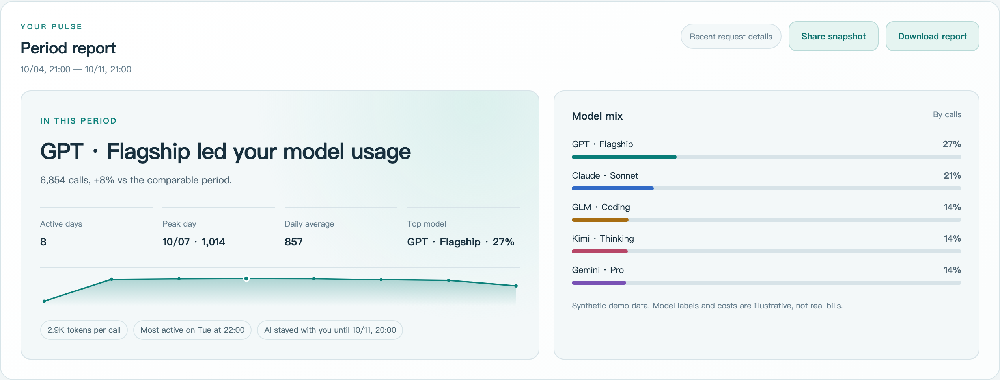
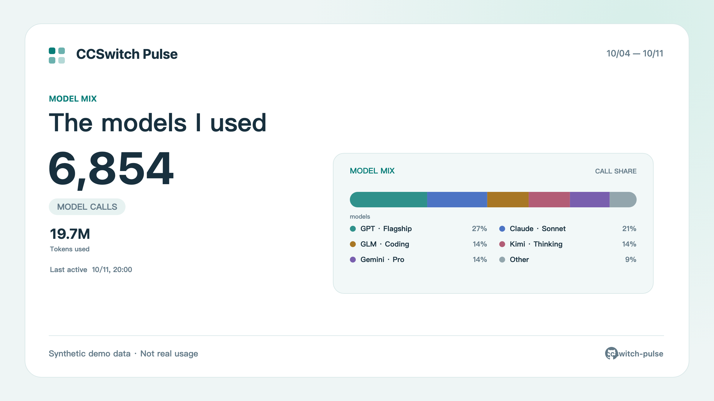

<p align="center">
  
</p>
<h1 align="center">CCSwitch Pulse</h1>
<p align="center"><strong>See the rhythm of your model usage. Understand the story behind it.</strong></p>
<p align="center">A local Web dashboard for CC Switch: replay the timeline, read period reports, and create a shareable usage card.</p>
<p align="center">
  <a href="https://github.com/aa8j/ccswitch-pulse/actions/workflows/ci.yml"></a>
  <a href="https://github.com/aa8j/ccswitch-pulse/blob/main/LICENSE"></a>
  <a href="README.md">简体中文</a> ·
  <a href="#quick-start">Quick start</a> ·
  <a href="#features">Features</a> ·
  <a href="#data-and-privacy">Data and privacy</a>
</p>


> Screenshots use fixed-anchor synthetic data and contain no personal usage records. Model names and distribution shapes follow the structure of aggregated local usage, not copied records. CCSwitch Pulse targets desktop browsers and supports Chinese, English, light, and dark themes.

## Quick start

### Run directly

The project is distributed from its GitHub repository; it does not need to be published to npm first. The default command reads the local CC Switch database:

```bash
npx -y "github:aa8j/ccswitch-pulse"
```

Without a database, use synthetic demo data:

```bash
npx -y "github:aa8j/ccswitch-pulse" --demo
```

### Run locally

```bash
git clone https://github.com/aa8j/ccswitch-pulse.git
cd ccswitch-pulse
npm ci
npm start
```

Run the local demo with:

```bash
npm start -- --demo
```

Live mode reads this file by default:

```text
~/.cc-switch/cc-switch.db
```

Choose another database with:

```bash
npm start -- --db /path/to/cc-switch.db
```

**Requirements:** Node.js 24.6+, npm/npx, and a desktop browser. The service listens only on `127.0.0.1`; data stays local.

## Updating

Current version: `v0.1.3`. The project does not auto-update local installations; updates are explicit so a data-reading change never happens unexpectedly.

### Track the latest main branch

```bash
npx --yes --prefer-online "github:aa8j/ccswitch-pulse"
```

### Use a stable release

After a release tag is published, pin a specific version with:

```bash
npx --yes "github:aa8j/ccswitch-pulse#v0.1.3"
```

### Update a local checkout

```bash
git pull --ff-only
npm ci
npm test
npm start
```

Updating replaces the program and dependencies; it never writes to the CC Switch database.

## Features

| What you want to know | What CCSwitch Pulse provides |
| --- | --- |
| Which models do I use most? | Model trends by range and bucket, with line, grouped-bar, stacked-bar, Top 5, and all-model views. |
| Where do usage peaks happen? | Timeline replay, current-bucket ranking, peak highlights, and a weekday × hour heatmap. Short ranges distinguish unobserved cells from observed zero activity. |
| What is the difference between requested and actual models? | Switch between the actual model and requested model; empty requested values fall back to the actual model. |
| Can I trust long-range history? | Retained request details and daily archives are kept separate; archival data is never presented as hourly or minute-level history. |
| Which records belong to one session? | Only imported details with stable `session_id` values are grouped; proxy requests are never guessed into conversations. |
| How do I take the results with me? | Export aggregated CSV, download a Markdown period report, or create a PNG share card locally in the browser. |
| What stays private? | APIs do not return prompts, responses, session IDs, or provider settings. Estimated cost is hidden by default, with Token and last-active privacy switches. |

## Reports and share cards

The period report includes the leading model, active days, peak usage, daily average, average tokens, model mix, and data coverage. Share cards include four themes: Period Story, Model Mix, Usage Rhythm, and Token Rhythm.

<details>
<summary><strong>Light theme and period report</strong></summary>




</details>

<details>
<summary><strong>Share card example</strong></summary>



</details>

## Usage

| Option | Purpose |
| --- | --- |
| `--demo` | Use fixed-anchor synthetic data without reading a database. Set `CCSWITCH_PULSE_DEMO_END` (Unix seconds) to move the demo anchor. |
| `--db PATH` | Select a CC Switch SQLite database; `CC_SWITCH_DB` is also supported. |
| `--port N` | Select a local port; default is `3456`; `0` chooses an available port. |
| `--no-open` | Start the server without opening a browser. |
| `--version` | Print the current version. |
| `--help` | Show CLI help. |

## Data and privacy

- **Read-only database:** Node's built-in SQLite opens the CC Switch database read-only; no migrations or writes are performed.
- **Local service:** the server binds to `127.0.0.1`; static assets and ECharts are served locally without an external CDN.
- **API boundary:** only GET / HEAD queries are exposed; prompts, responses, session IDs, project paths, and provider settings are not returned.
- **Definitions:** tokens combine input, output, cache reads, and cache creation. Cost is the estimated USD value recorded by CC Switch, not a provider invoice.
- **Historical boundary:** `usage_daily_rollups` has no `data_source` or `session_id` dimension, so source filters, recent activity, and sessions apply to retained details only.
- **Private sharing:** images contain aggregate data for the chosen range. Estimated cost is hidden by default, and Token / last-active fields can be disabled independently.

See [schema support](docs/SCHEMA_SUPPORT.md) for required fields, optional fields, and compatibility behavior.

## Development and verification

```bash
npm ci
npm test
npm run check:syntax
npm run smoke:cli
npm run test:e2e
npm run benchmark -- 100000
npm run pack:check
```

The project includes desktop Playwright E2E, cross-platform GitHub Actions, an MIT license, and a release checklist.

Project layout:

```text
bin/       CLI entry point
src/       SQLite queries, reports, server, and demo data
public/    UI, charts, themes, and bilingual copy
e2e/       Desktop E2E
test/      Data, server, CLI, and schema tests
docs/      Product boundaries, schema support, and release checklist
```

## API

```text
GET /api/meta
GET /api/series
GET /api/requests
GET /api/report
GET /api/sessions
GET /api/heatmap
```

## FAQ

<details>
<summary>The dashboard cannot find my database.</summary>

Check that CC Switch has recorded usage. Use `--db PATH` if the database is elsewhere, or `--demo` to preview the UI.

</details>

<details>
<summary>Why does cost differ from my bill?</summary>

The dashboard displays estimated USD cost already recorded by CC Switch. Model prices, discounts, cache billing, and settlement rules may differ; your provider's invoice is authoritative.

</details>

## License

MIT

## Star History

<a href="https://star-history.com/#aa8j/ccswitch-pulse&Date">
  <picture>
    <source media="(prefers-color-scheme: dark)" srcset="https://api.star-history.com/svg?repos=aa8j/ccswitch-pulse&type=Date&theme=dark" />
    <source media="(prefers-color-scheme: light)" srcset="https://api.star-history.com/svg?repos=aa8j/ccswitch-pulse&type=Date" />
    
  </picture>
</a>
