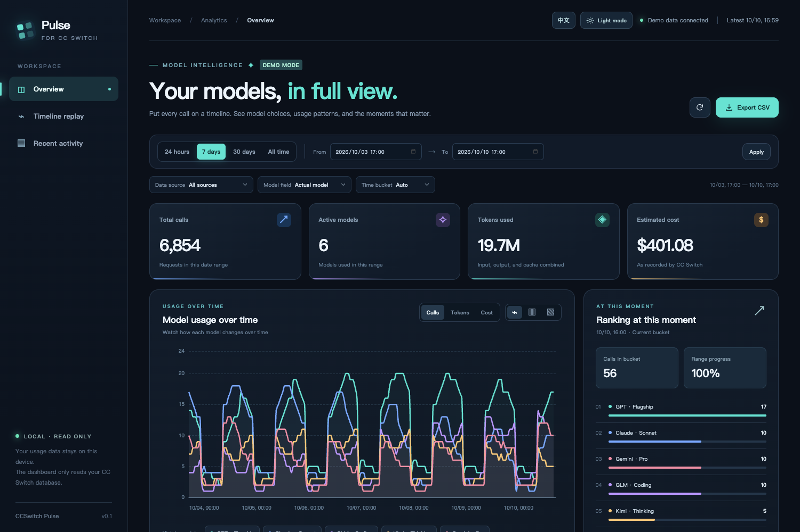
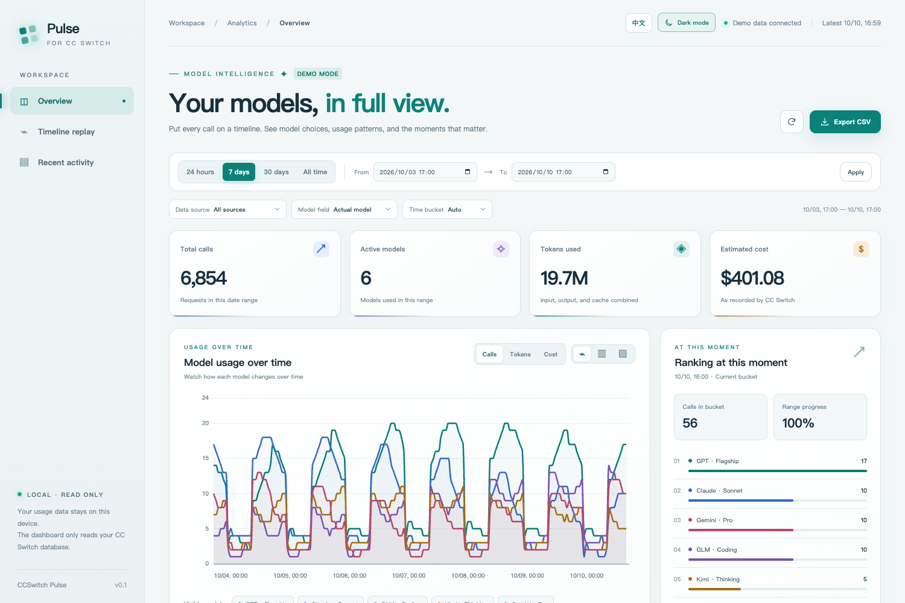

<p align="center">
  
</p>
<h1 align="center">CCSwitch Pulse</h1>
<p align="center"><strong>Put every model call back on the timeline.</strong></p>
<p align="center">A local Web dashboard for CC Switch: explore trends, compare models, replay usage.</p>
<p align="center">
  <a href="README.md">简体中文</a> ·
  <a href="#start-in-one-minute">Quick start</a> ·
  <a href="#what-you-can-do">Features</a> ·
  <a href="#data-and-privacy">Data and privacy</a>
</p>



> Screenshots use **synthetic demo data** and contain no personal usage records. The dashboard is designed for desktop browsers. It supports light and dark themes plus Chinese and English; your choices are saved in your browser.

## Start in one minute

After uploading the project to your GitHub account, replace `YOUR_GITHUB_USER` with your actual username:

```bash
npx -y github:YOUR_GITHUB_USER/ccswitch-pulse
```

The command installs dependencies, reads `~/.cc-switch/cc-switch.db` by default, and opens the local dashboard in a browser. Press `Ctrl+C` to stop. **This repository has not been uploaded to GitHub yet**; the remote command works after publication.

Want to explore without a database?

```bash
npx -y github:YOUR_GITHUB_USER/ccswitch-pulse --demo
```

With a local checkout, run `npm ci && npm start` or `npm start -- --demo` for sample data.

**Requirements:** Node.js 24.6+, npm/npx, and a desktop browser. Live mode needs a local CC Switch SQLite usage database; demo mode does not. Publishing to the npm registry is optional: the repository declares a single CLI `bin` entry, so npx can run it from GitHub.

## What you can do

| Question | In the dashboard |
| --- | --- |
| Which models did I use most, and when? | Choose a date range and bucket size; compare models with line, grouped bar, or stacked bar charts. |
| Did a usage spike appear suddenly? | Scrub to any point and press Play. The chart, current-bucket ranking, and progress move together. Pause, step, or use 0.5×–4× speed. |
| Do calls, tokens, and costs tell the same story? | Switch metrics and filter by data source, actual model, or requested model. |
| Can I take the analysis elsewhere? | Review overview cards, peak highlights, and recent calls; export an aggregated CSV for the selected range. |

**Comfortable for long sessions:** use the light theme by day and dark theme at night. Switch the whole interface between English and Chinese at any time. Charts, controls, feedback, and timeline labels update together without resetting your filters or playback position.

<details>
<summary><strong>See the light theme</strong></summary>
<br />



</details>

## Running it

Choose another database file:

```bash
npx -y github:YOUR_GITHUB_USER/ccswitch-pulse --db /path/to/cc-switch.db
```

| Option | Purpose |
| --- | --- |
| `--demo` | Preview synthetic data without reading a database. Demo model labels and costs are illustrative, not real provider data. |
| `--db PATH` | Select a CC Switch SQLite file; `CC_SWITCH_DB` is also supported. |
| `--port N` | Select a local port; default is `3456`. Use `0` to choose an available port. |
| `--no-open` | Start the server without opening a browser. |
| `--help` | Show CLI help. |

The server listens only on `127.0.0.1`. If the default port is busy, use `--port 0`; the CLI prints the actual URL.

## Data and privacy

- **Read-only database:** Node's built-in SQLite opens the CC Switch file read-only. The HTTP API exposes `GET` queries and no mutation endpoint.
- **Local by default:** the server binds to `127.0.0.1`. ECharts is served from the installed local dependency, with no external CDN. The API does not return prompts, responses, error bodies, or session content.
- **Definitions:** calls count `proxy_request_logs` records in the range; empty chart buckets show zero. Tokens combine input, output, cache reads, and cache creation. Cost is the estimated USD value recorded by CC Switch, **not a provider invoice**.
- **Models and sources:** “Actual model” uses `model`; “Requested model” prefers `request_model` and falls back to `model`. Proxy requests and imported sessions can be filtered separately. Imported status codes are not treated as measured HTTP success rates.
- **Safe sharing:** `.gitignore` excludes database, WAL, and SHM files. Still review commits before publication to avoid sharing personal logs.

This project is not affiliated with the CC Switch maintainers. Database schema changes may require updates to `src/data.js`.

## Develop locally

```bash
git clone https://github.com/YOUR_GITHUB_USER/ccswitch-pulse.git
cd ccswitch-pulse
npm ci
npm start -- --demo
```

The front end has no build step. Run `npm test` for aggregation, filtering, and read-only behavior; run `npm run pack:check` to inspect distributable files. The project includes an MIT license and GitHub Actions CI.

```text
bin/ccswitch-pulse.js  CLI arguments, startup, browser launch
src/data.js            Read-only SQLite queries, validation, aggregation
src/demo.js            Synthetic rolling demo data
src/server.js          Local HTTP server and static assets
public/                UI, charts, themes, and bilingual copy
test/                  Data behavior tests
```

The API provides `GET /api/meta`, `GET /api/series`, and `GET /api/requests`. To support another CC Switch schema version, start with `src/data.js`.

## FAQ

<details>
<summary>The dashboard cannot find my database.</summary>

Check that CC Switch has recorded usage and that `~/.cc-switch/cc-switch.db` exists. Use `--db PATH` if your file is elsewhere, or `--demo` to preview the UI.

</details>

<details>
<summary>Why do I see an SQLite ExperimentalWarning?</summary>

This is emitted by Node 24's built-in SQLite module. The project still queries the file read-only. Use Node.js 24.6 or newer.

</details>

<details>
<summary>Why does cost differ from my bill?</summary>

The dashboard displays estimated USD cost already recorded by CC Switch. Model prices, discounts, cache billing, and settlement rules may differ; your provider's invoice is authoritative.

</details>

## Publish on GitHub

1. Create a public `ccswitch-pulse` repository and push this project's Git commits.
2. Replace `YOUR_GITHUB_USER` in both READMEs with your actual username. You can use the dark screenshot as the repository's Social preview.
3. On a machine without a local checkout, run `npx -y github:YOUR_GITHUB_USER/ccswitch-pulse --demo` to verify GitHub installation and browser startup.
4. Optionally tag the first release `v0.1.0`. Users can pin it with `npx -y github:YOUR_GITHUB_USER/ccswitch-pulse#v0.1.0`.

Issues and pull requests are welcome, especially reports about different CC Switch database versions.

## License

MIT
