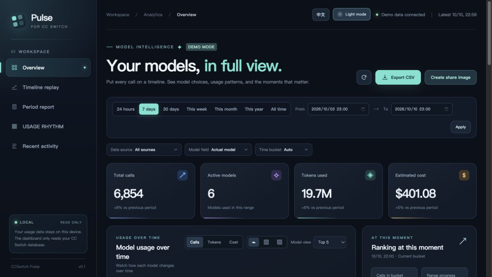
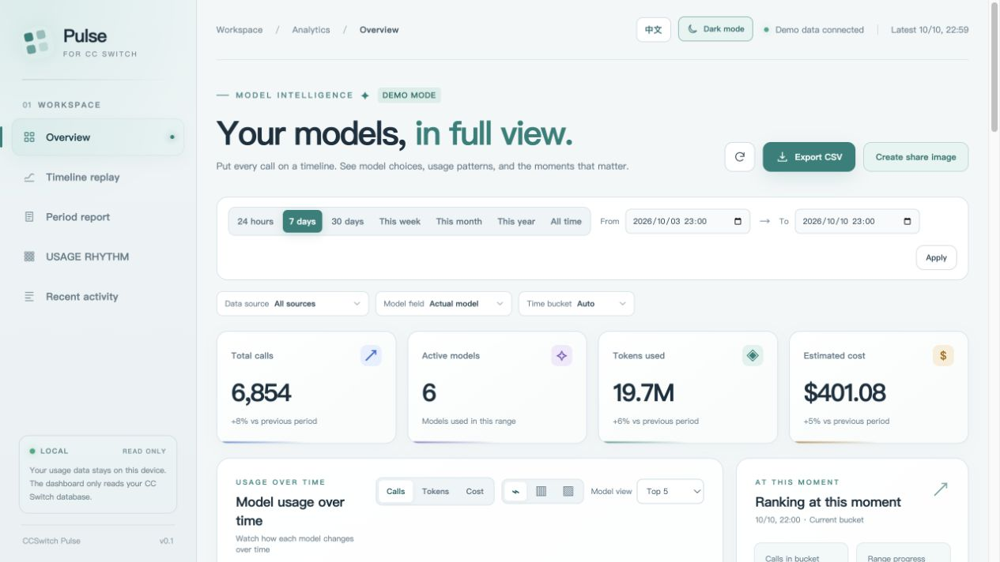

<p align="center">
  
</p>
<h1 align="center">CCSwitch Pulse</h1>
<p align="center"><strong>See the rhythm of your model usage. Understand the story behind it.</strong></p>
<p align="center">A local Web dashboard for CC Switch: replay the timeline, read period reports, and create a shareable usage card.</p>
<p align="center">
  <a href="README.md">简体中文</a> ·
  <a href="#start-in-one-minute">Quick start</a> ·
  <a href="#what-you-can-do">Features</a> ·
  <a href="#data-and-privacy">Data and privacy</a>
</p>



> Screenshots use **synthetic demo data** and contain no personal usage records. The dashboard is designed for desktop browsers. It supports light and dark themes plus Chinese and English; your choices are saved in your browser.

## Start in one minute

Run from a local checkout:

```bash
npm ci
npm start
```

After the repository is public, run it from GitHub:

```bash
npx -y "github:aa8j/ccswitch-pulse"
```

The command reads `~/.cc-switch/cc-switch.db` by default and opens the local dashboard in a browser. Press `Ctrl+C` to stop. The repository owner is `aa8j`.

Want to explore without a database?

```bash
npm start -- --demo
```

After publication, the GitHub form is:

```bash
npx -y "github:aa8j/ccswitch-pulse" --demo
```

With a local checkout, run `npm ci && npm start` or `npm start -- --demo` for sample data.

**Requirements:** Node.js 24.6+, npm/npx, and a desktop browser. Live mode needs a local CC Switch SQLite usage database; demo mode does not. Publishing to the npm registry is optional: the repository declares a single CLI `bin` entry, so npx can run it from GitHub.

## What you can do

| Question | In the dashboard |
| --- | --- |
| Which models did I use most, and when? | Choose a date range and bucket size; compare models with line, grouped bar, or stacked bar charts. Top 5 is the default, with an all-model view when needed. |
| Did a usage spike appear suddenly? | Scrub to any point and press Play. The chart, current-bucket ranking, and progress move together. Pause, step, or use 0.5×–4× speed. |
| Do calls, tokens, and costs tell the same story? | Switch metrics and filter by data source, actual model, or requested model. |
| Can I take the analysis elsewhere? | Review overview cards, peak highlights, and recent calls. Click any call to expand input/output tokens, source, cost, and status, then jump back to the timeline; export an aggregated CSV for the selected range. |
| What changed this week, month, or year? | Select calendar periods or custom dates. Read the report, model mix, active days, and comparable changes, then download a Markdown report. |
| Can I share a clear picture? | Create a report snapshot for a day, week, month, year, all time, or a custom range. It includes calls, tokens, last active time, model mix, and the GitHub repository mark. Preview, then download or copy it. Estimated cost is hidden by default, and rendering stays in the browser. |
| Which calls truly belong to a session? | Group only imported records with stable session identifiers, with duration and model details. Proxy requests are never guessed into “conversations.” |
| When do I usually use models? | Use the weekday × hour heatmap, peak period, busiest day, and quiet hours. It only uses retained request details; daily archives are never presented as hourly history. |
| Can I share directly from a report? | Generate a snapshot from the period report with Period Story, Model Mix, Usage Rhythm, or Token Rhythm. Tokens and last-active time are optional; estimated cost stays hidden by default. |

**Comfortable for long sessions:** use the light theme by day and dark theme at night. Switch the whole interface between English and Chinese at any time. Charts, controls, feedback, and timeline labels update together without resetting your filters or playback position.

**Reports you can trust:** “Last 7 Days” and “This Week” are different ranges. Current calendar periods compare against the same elapsed span of the prior period. Archived daily totals are combined with retained request details, and the report shows data coverage. Daily archives are never presented as minute-level history; the heatmap only claims what retained hourly details can support.

<details>
<summary><strong>See the light theme</strong></summary>
<br />



</details>

<details>
<summary><strong>Period report and share card</strong></summary>
<br />

The period report brings together the leading model, active days, peak usage, daily average, average tokens per call, and period facts. Generate a snapshot directly from the report with four themes, privacy toggles for tokens/last active, and a GitHub repository mark.


</details>

## Running it

Choose another database file:

```bash
npx -y "github:aa8j/ccswitch-pulse" --db /path/to/cc-switch.db
```

| Option | Purpose |
| --- | --- |
| `--demo` | Preview fixed-anchor synthetic data without reading a database. Demo model labels and costs are illustrative, not real provider data. Set `CCSWITCH_PULSE_DEMO_END` (Unix seconds) to move the demo anchor. |
| `--db PATH` | Select a CC Switch SQLite file; `CC_SWITCH_DB` is also supported. |
| `--port N` | Select a local port; default is `3456`. Use `0` to choose an available port. |
| `--no-open` | Start the server without opening a browser. |
| `--help` | Show CLI help. |

The server listens only on `127.0.0.1`. If the default port is busy, use `--port 0`; the CLI prints the actual URL.

## Data and privacy

- **Read-only database:** Node's built-in SQLite opens the CC Switch file read-only. The HTTP API exposes `GET` queries and no mutation endpoint.
- **Local by default:** the server binds to `127.0.0.1`. ECharts is served from the installed local dependency, with no external CDN. The API does not return prompts, responses, error bodies, or session content.
- **Definitions:** calls combine retained `proxy_request_logs` records and CC Switch `usage_daily_rollups` archival counts. Archives and retained details represent different records. Empty chart buckets show zero. Tokens combine input, output, cache reads, and cache creation. Cost is the estimated USD value recorded by CC Switch, **not a provider invoice**.
- **Models and sources:** “Actual model” uses `model`; “Requested model” prefers `request_model` and falls back to `model`. Proxy requests and imported sessions can be filtered separately. Imported status codes are not treated as measured HTTP success rates.
- **Historical limits:** daily rollups have no `data_source` or `session_id` dimension. Source filters, recent calls, and session view cover retained details only. A partial day in the archive cannot be reconstructed at hourly precision. Demo mode uses the same archive-plus-recent boundary.
- **Private sharing:** images contain aggregate data for the chosen range. Estimated cost is hidden by default. Prompts, responses, session IDs, project paths, and provider settings are not included. You choose whether to download, copy, or publish an image. The Token Rhythm template uses total tokens as its primary metric.
- **Safe sharing:** `.gitignore` excludes database, WAL, and SHM files. Still review commits before publication to avoid sharing personal logs.

This project is not affiliated with the CC Switch maintainers. See [schema support](docs/SCHEMA_SUPPORT.md) for required and optional fields; schema changes may require updates to `src/data.js`.

## Develop locally

```bash
git clone "https://github.com/aa8j/ccswitch-pulse.git"
cd ccswitch-pulse
npm ci
npm start -- --demo
```

The front end has no build step. Run `npm test` for aggregation, filtering, and read-only behavior; run `npm run check:syntax` for JavaScript syntax; run `npm run smoke:cli` for a CLI/API smoke check; run `npm run test:e2e` for desktop-flow regression; run `npm run benchmark -- 100000` for a data-volume baseline; run `npm run pack:check` to inspect distributable files. The project includes an MIT license and GitHub Actions CI.

```text
bin/ccswitch-pulse.js  CLI arguments, startup, browser launch
src/data.js            Read-only SQLite queries, validation, aggregation
src/report.js          Period reports and comparable period summaries
src/demo.js            Nearly a year of synthetic demo data
src/server.js          Local HTTP server and static assets
public/                UI, charts, themes, and bilingual copy
test/                  Data behavior tests
```

The API provides `GET /api/meta`, `GET /api/series`, `GET /api/requests`, `GET /api/report`, and `GET /api/sessions`. To support another CC Switch schema version, start with `src/data.js`. Product decisions and release checks are in [Product acceptance](docs/PRODUCT_ACCEPTANCE.md).

## FAQ

<details>
<summary>The dashboard cannot find my database.</summary>

Check that CC Switch has recorded usage and that `~/.cc-switch/cc-switch.db` exists. Use `--db PATH` if your file is elsewhere, or `--demo` to preview the UI.

</details>

<details>
<summary>Why do I see an SQLite ExperimentalWarning?</summary>

The CLI hides the notice from Node 24's built-in SQLite module. The project still queries the file read-only. Use Node.js 24.6 or newer.

</details>

<details>
<summary>Why does cost differ from my bill?</summary>

The dashboard displays estimated USD cost already recorded by CC Switch. Model prices, discounts, cache billing, and settlement rules may differ; your provider's invoice is authoritative.

</details>

## Publish on GitHub

1. Create a public `ccswitch-pulse` repository and push this project's Git commits.
2. Use the dark screenshot as the repository's Social preview.
3. On a machine without a local checkout, run `npx -y "github:aa8j/ccswitch-pulse" --demo` to verify GitHub installation and browser startup.
4. Optionally tag the first release `v0.1.0`. Users can pin it with `npx -y "github:aa8j/ccswitch-pulse#v0.1.0"`.

Issues and pull requests are welcome, especially reports about different CC Switch database versions.

## License

MIT

## Star History

<a href="https://star-history.com/#aa8j/ccswitch-pulse&Date">
  <picture>
    <source media="(prefers-color-scheme: dark)" srcset="https://api.star-history.com/svg?repos=aa8j/ccswitch-pulse&type=Date&theme=dark" />
    <source media="(prefers-color-scheme: light)" srcset="https://api.star-history.com/svg?repos=aa8j/ccswitch-pulse&type=Date" />
    
  </picture>
</a>
