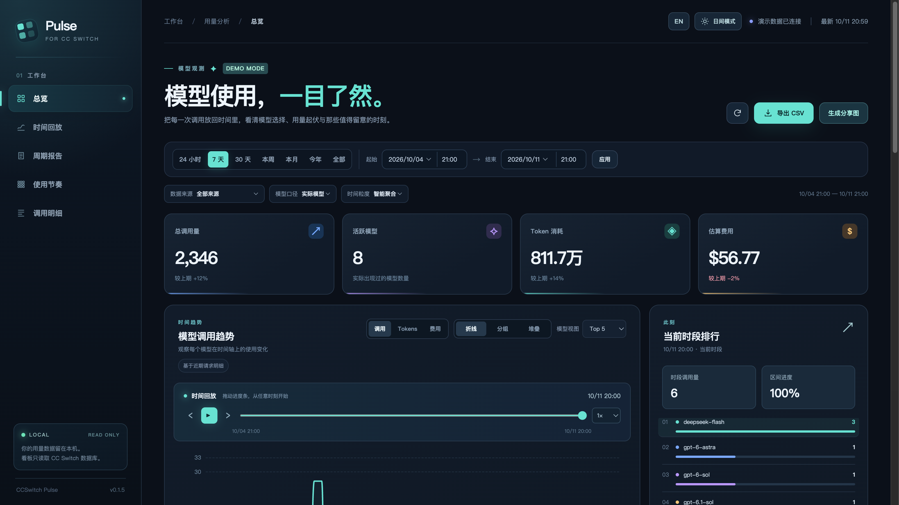
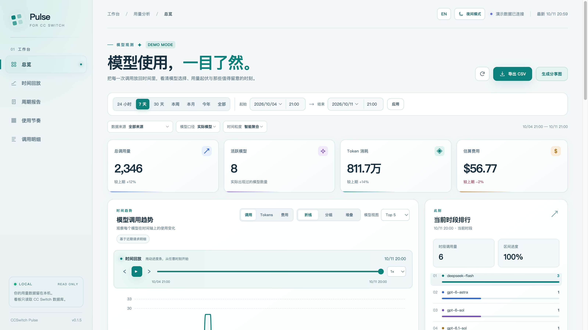
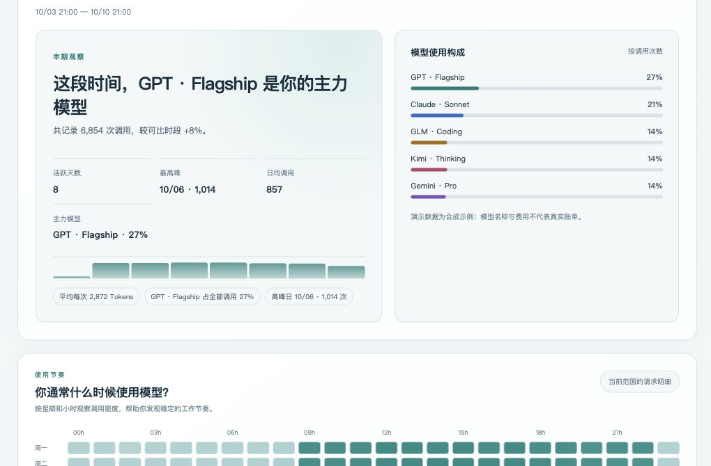
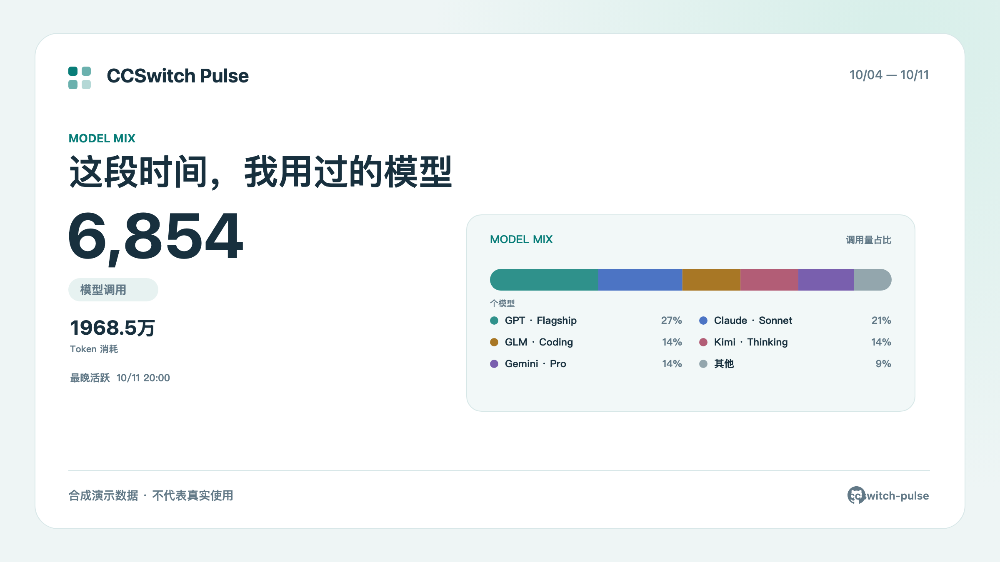

<p align="center">
  
</p>
<h1 align="center">CCSwitch Pulse</h1>
<p align="center"><strong>看见模型使用的节奏，也读懂这一周的故事。</strong></p>
<p align="center">为 CC Switch 打造的本地 Web 看板：回放时间线、生成周期报告，做一张愿意分享的用量卡片。</p>
<p align="center">
  <a href="https://github.com/aa8j/ccswitch-pulse/actions/workflows/ci.yml"></a>
  <a href="https://github.com/aa8j/ccswitch-pulse/blob/main/LICENSE"></a>
  <a href="README.en.md">English</a> ·
  <a href="#快速开始">快速开始</a> ·
  <a href="#功能">功能</a> ·
  <a href="#数据与隐私">数据与隐私</a>
</p>



> 截图使用固定锚点的合成数据，不包含个人调用记录；模型名称和分布形状参考本地聚合数据的结构，不复制真实记录。CCSwitch Pulse 面向桌面浏览器，支持中英文、浅色和深色主题。

## 快速开始

### 直接运行

项目通过 GitHub 仓库分发，无需先发布到 npm。默认读取本机 CC Switch 数据库：

```bash
npx -y "github:aa8j/ccswitch-pulse"
```

没有数据库时，使用演示数据：

```bash
npx -y "github:aa8j/ccswitch-pulse" --demo
```

### 本地运行

```bash
git clone https://github.com/aa8j/ccswitch-pulse.git
cd ccswitch-pulse
npm ci
npm start
```

本地预览演示数据：

```bash
npm start -- --demo
```

正式数据模式默认读取：

```text
~/.cc-switch/cc-switch.db
```

也可以指定数据库：

```bash
npm start -- --db /path/to/cc-switch.db
```

**环境要求：** Node.js 24.6+、npm/npx 和桌面浏览器。服务只监听 `127.0.0.1`，数据留在本机。

## 更新

当前版本：`v0.1.5`。项目不会自动更新本地程序，避免在没有确认的情况下改变数据读取逻辑；更新由你显式选择版本。

### 使用最新主线

```bash
npx --yes --prefer-online "github:aa8j/ccswitch-pulse"
```

### 使用稳定版本

固定到本次发布的版本：

```bash
npx --yes "github:aa8j/ccswitch-pulse#v0.1.5"
```

### 更新本地源码

```bash
git pull --ff-only
npm ci
npm test
npm start
```

更新只替换程序和依赖，不会写入 CC Switch 数据库。

## 功能

| 你想了解什么 | CCSwitch Pulse 提供什么 |
| --- | --- |
| 哪些模型使用最多？ | 按时间范围和粒度查看模型趋势，支持折线图、分组柱状图、堆叠柱状图和 Top 5 / 全部模型。 |
| 使用高峰发生在哪里？ | 回放时间线，查看当前时段排行、峰值和星期 × 小时热力图。短范围会区分“未观测”与“无调用”。 |
| 请求模型和实际模型有什么差异？ | 在实际模型和请求模型之间切换，空的请求模型自动回退到实际模型。 |
| 历史数据是否可信？ | 近期请求明细与历史日汇总分层统计；归档数据不会被伪装成小时或分钟级记录。 |
| 哪些记录属于同一会话？ | 只对带稳定 `session_id` 的导入明细聚合会话，不把代理请求猜成对话。 |
| 怎样带走结果？ | 导出聚合 CSV，下载 Markdown 周期报告，或在浏览器本地生成 PNG 分享卡。 |
| 怎样保护隐私？ | API 不返回提示词、回复、会话 ID 或 provider 配置；分享卡默认隐藏估算费用，并提供 Token / 最晚活跃开关。 |

## 报告与分享卡

周期报告包含主力模型、活跃天数、峰值、周期日均、平均 Token、模型构成和数据覆盖说明。分享卡支持四种主题：周期故事、模型构成、使用节奏和 Token 节奏。

<details>
<summary><strong>浅色主题与周期报告</strong></summary>





</details>

<details>
<summary><strong>分享卡示例</strong></summary>



</details>

## 使用方式

| 选项 | 作用 |
| --- | --- |
| `--demo` | 使用固定锚点的合成数据，不读取数据库。可用 `CCSWITCH_PULSE_DEMO_END`（Unix 秒）改变演示结束时间。 |
| `--db PATH` | 指定 CC Switch SQLite 数据库；也可使用 `CC_SWITCH_DB`。 |
| `--port N` | 指定本地端口，默认 `3456`；`0` 表示自动选择可用端口。 |
| `--no-open` | 启动服务但不自动打开浏览器。 |
| `--version` | 输出当前版本。 |
| `--help` | 查看 CLI 帮助。 |

## 数据与隐私

- **只读数据库：** 使用 Node 内置 SQLite 只读打开 CC Switch 数据库，不执行迁移和写入。
- **本地服务：** 服务绑定 `127.0.0.1`，静态资源和 ECharts 使用本地依赖，不依赖外部 CDN。
- **API 边界：** 只提供 GET / HEAD 查询，不返回 prompt、response、session ID、项目路径或 provider 配置。
- **统计定义：** Token 包含输入、输出、缓存读取和缓存创建；费用是 CC Switch 已记录的估算美元值，不是供应商账单。
- **历史边界：** `usage_daily_rollups` 没有 `data_source` 和 `session_id` 维度，因此来源筛选、近期调用和会话视图只针对保留明细。
- **分享隐私：** 图片只包含选定范围的聚合数据；费用默认隐藏，Token 和最晚活跃可以单独关闭。

数据库支持的必需字段、可选字段和兼容策略见[数据库支持范围](docs/SCHEMA_SUPPORT.md)。

## 开发与验证

```bash
npm ci
npm test
npm run check:syntax
npm run smoke:cli
npm run test:e2e
npm run benchmark -- 100000
npm run pack:check
```

项目包含桌面端 Playwright E2E、跨平台 GitHub Actions、MIT 许可证和发布清单。

主要目录：

```text
bin/       CLI 入口
src/       SQLite 查询、报告、服务端和演示数据
public/    页面、图表、主题和双语文案
e2e/       桌面端 E2E
test/      数据、服务端、CLI 和 schema 测试
docs/      产品边界、数据库支持和发布清单
```

## API

```text
GET /api/meta
GET /api/series
GET /api/requests
GET /api/report
GET /api/sessions
GET /api/heatmap
```

## FAQ

<details>
<summary>页面提示找不到数据库怎么办？</summary>

确认 CC Switch 已产生用量记录；数据库不在默认位置时使用 `--db PATH`，只想体验界面时使用 `--demo`。

</details>

<details>
<summary>费用为什么和账单不同？</summary>

看板展示 CC Switch 已记录的估算费用。模型价格、折扣、缓存计费和供应商结算方式可能不同，账单以供应商为准。

</details>

## License

MIT

## Star History

<a href="https://star-history.com/#aa8j/ccswitch-pulse&Date">
  <picture>
    <source media="(prefers-color-scheme: dark)" srcset="https://api.star-history.com/svg?repos=aa8j/ccswitch-pulse&type=Date&theme=dark" />
    <source media="(prefers-color-scheme: light)" srcset="https://api.star-history.com/svg?repos=aa8j/ccswitch-pulse&type=Date" />
    
  </picture>
</a>
