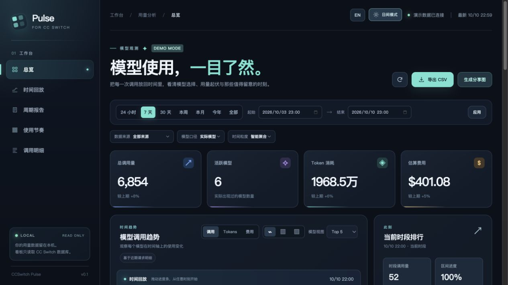

<p align="center">
  
</p>
<h1 align="center">CCSwitch Pulse</h1>
<p align="center"><strong>看见模型使用的节奏，也读懂这一周的故事。</strong></p>
<p align="center">为 CC Switch 打造的本地 Web 看板：回放时间线、生成周期报告，做一张愿意分享的用量卡片。</p>
<p align="center">
  <a href="README.en.md">English</a> ·
  <a href="#一分钟开始">快速开始</a> ·
  <a href="#它能做什么">功能</a> ·
  <a href="#数据与隐私">数据与隐私</a>
</p>



> 截图来自内置的**合成演示数据**，不包含个人调用记录。界面面向桌面浏览器；支持日间、夜间主题及中文、English 切换，选择会保存在本机浏览器中。

## 一分钟开始

本地源码运行：

```bash
npm ci
npm start
```

仓库公开后，从 GitHub 运行：

```bash
npx -y "github:aa8j/ccswitch-pulse"
```

命令会读取默认位置 `~/.cc-switch/cc-switch.db`，并在浏览器打开本地看板。按 `Ctrl+C` 结束服务。仓库 owner 已固定为 `aa8j`。

想先体验界面，无需准备数据库：

```bash
npm start -- --demo
```

仓库公开后，也可以运行：

```bash
npx -y "github:aa8j/ccswitch-pulse" --demo
```

已有本地源码时，直接在项目目录运行 `npm ci && npm start`；预览演示数据运行 `npm start -- --demo`。

**环境要求：**Node.js 24.6+、npm/npx、桌面浏览器。正式数据模式需要本机 CC Switch 的 SQLite 用量数据库；演示模式不需要。无需发布到 npm 仓库：项目根目录只有一个 CLI `bin` 入口，支持 GitHub 包地址直接运行。

## 它能做什么

| 想看清的问题 | 看板里的操作 |
| --- | --- |
| 哪些模型在什么时候用得最多？ | 选时间范围和粒度，比较多模型折线图、分组柱状图或堆叠柱状图；默认聚焦 Top 5，也可展开全部模型。 |
| 用量高峰是突然出现的吗？ | 拖到任意时间点，点击播放；图表、当前时段排行和进度会一起前进。支持暂停、逐格移动和 0.5×–4× 调速。 |
| 调用量、Token 和费用的趋势一样吗？ | 一键切换三个指标，并按数据来源、实际模型或请求模型筛选。 |
| 想带走分析结果？ | 查看概览卡片、峰值提示、最近调用；点击任意调用记录展开输入/输出 Token、来源、费用和状态，并可定位回时间轴；导出所选区间的聚合 CSV。 |
| 本周、本月或今年发生了什么变化？ | 选择日历周、月、年或自定义范围，读周期报告、模型构成、活跃天数和可比时段变化；可下载 Markdown 报告。 |
| 想把结果分享出去？ | 生成当前日、周、月、年、全部或自定义时段的报告快照 PNG：包含调用量、Token、最晚活跃时间、模型构成和 GitHub 仓库标识。先预览，再下载或复制；估算费用默认隐藏，生成过程仅在浏览器本地进行。 |
| 哪些记录确实属于同一会话？ | 只对带有稳定会话标识的导入记录做会话聚合，并显示持续时间与使用过的模型，不把代理请求凭空合成“对话”。 |
| 我通常在什么时候使用模型？ | 查看星期 × 小时热力图、峰值时段、最活跃日和安静时段；它只使用保留的请求明细，历史日汇总不会伪装成小时数据。 |
| 想从报告直接分享？ | 周期报告内直接生成快照，可选择周期故事、模型构成、使用节奏或 Token 节奏；Token 和最晚活跃可单独隐藏，费用默认隐藏。 |

**为长时间使用设计：**浅色适合白天，深色适合夜晚；中英文界面随时切换。图表、控件、提示和时间轴标签会同步更新，筛选与回放进度不会因切换而重置。

**让报告可信：**「近 7 天」与「本周」分别计算；本周、本月、今年与上期相同进度比较。历史日汇总与保留的请求明细一起统计，报告会提示数据覆盖范围。只有日粒度的归档数据不会伪装成分钟曲线；热力图只对有小时信息的明细负责。

<details>
<summary><strong>看看日间主题</strong></summary>
<br />


</details>

<details>
<summary><strong>报告与分享图</strong></summary>
<br />

周期报告把主力模型、活跃天数、峰值、日均调用、平均 Token 和周期事实放在一起；报告顶部直接生成分享快照，支持四种主题、Token/最晚活跃隐私开关和 GitHub 仓库标识。


</details>

## 使用方式

指定其他数据库路径：

```bash
npx -y "github:aa8j/ccswitch-pulse" --db /path/to/cc-switch.db
```

常用选项：

| 选项 | 作用 |
| --- | --- |
| `--demo` | 使用固定锚点的合成数据预览，不读取数据库。示例模型标签和费用都不代表真实厂商数据。可用 `CCSWITCH_PULSE_DEMO_END`（Unix 秒）改变演示结束时间。 |
| `--db PATH` | 指定 CC Switch SQLite 数据库；也可设环境变量 `CC_SWITCH_DB`。 |
| `--port N` | 指定本地端口，默认 `3456`；`0` 表示自动选择可用端口。 |
| `--no-open` | 启动服务，但不自动打开浏览器。 |
| `--help` | 查看 CLI 帮助。 |

服务仅监听 `127.0.0.1`。如果默认端口被占用，可用 `--port 0`；终端会打印实际访问地址。

## 数据与隐私

- **只读数据库：**通过 Node 内置 SQLite 以只读方式打开 CC Switch 数据库；HTTP 接口只提供 `GET` 查询，不提供修改入口。
- **留在本机：**看板服务默认只绑定 `127.0.0.1`；ECharts 从本机安装的依赖提供，没有外部 CDN。API 不返回提示词、回复内容、错误正文或会话内容。
- **统计口径：**“调用量”是选中范围内的请求记录数，加上 CC Switch 已归档的 `usage_daily_rollups` 请求数；归档与保留明细代表不同的记录。空时间段会在图上补零。Token 为输入、输出、缓存读取与缓存创建之和。费用取 CC Switch 记录的美元估算值，**不是供应商账单**。
- **模型与来源：**“实际模型”读取 `model`；“请求模型”优先使用 `request_model`，为空时回退。代理请求和会话导入可分别筛选；看板不会把导入记录的状态码解释成真实 HTTP 成功率。
- **历史限制：**CC Switch 的日汇总表没有 `data_source` 和 `session_id` 维度，因此来源筛选、最近调用和会话视图只覆盖仍保留的明细。自定义范围若只落在归档日期的部分时段，不能从日汇总还原精确小时数。演示模式也按同样的“历史日汇总 + 近期明细”边界展示。
- **分享隐私：**图片仅包含选定时间段的聚合数据；默认不显示估算费用，不包含提示词、回复、会话 ID、项目路径或服务商配置。需由你主动下载、复制或发布。Token 节奏模板会把 Token 总量作为主指标。
- **开源安全：**`.gitignore` 排除数据库、WAL、SHM 文件。发布前仍请检查提交内容，避免把个人调用日志带入仓库。

本项目与 CC Switch 官方无关联。当前支持的表结构、可选字段和不支持情况见 [数据库支持范围](docs/SCHEMA_SUPPORT.md)。

## 本地开发

```bash
git clone "https://github.com/aa8j/ccswitch-pulse.git"
cd ccswitch-pulse
npm ci
npm start -- --demo
```

页面无需前端构建。运行 `npm test` 验证聚合、筛选和只读约束；运行 `npm run check:syntax` 检查 JavaScript；运行 `npm run smoke:cli` 做 CLI/API 冒烟；运行 `npm run test:e2e` 验证桌面端核心流程；运行 `npm run benchmark -- 100000` 建立数据量基线；运行 `npm run pack:check` 检查可分发内容。项目包含 MIT 许可证和 GitHub Actions CI。

```text
bin/ccswitch-pulse.js  CLI 参数、启动与打开浏览器
src/data.js            SQLite 只读查询、参数校验、聚合
src/report.js          周期报告与可比时段汇总
src/demo.js            覆盖近一年的合成演示数据
src/server.js          本地 HTTP 服务与静态资源
public/                页面、图表、日夜主题和双语界面
test/                  数据行为测试
```

API 分为 `GET /api/meta`、`GET /api/series`、`GET /api/requests`、`GET /api/report` 和 `GET /api/sessions`。如果要适配其他 CC Switch 数据库版本，通常从 `src/data.js` 开始。产品取舍与发布验收条件见 [产品验收说明](docs/PRODUCT_ACCEPTANCE.md)。

## 常见问题

<details>
<summary>页面提示找不到数据库？</summary>

确认 CC Switch 已产生用量记录，并检查 `~/.cc-switch/cc-switch.db` 是否存在。数据库在其他位置时使用 `--db PATH`；只看界面时使用 `--demo`。

</details>

<details>
<summary>启动时出现 SQLite ExperimentalWarning？</summary>

CLI 会隐藏 Node 24 内置 SQLite 的 ExperimentalWarning；项目仍以只读方式查询。请使用 Node.js 24.6 或更新版本。

</details>

<details>
<summary>为什么费用与账单不同？</summary>

看板展示 CC Switch 数据库已经记录的估算美元费用。模型价格、折扣、缓存计费及供应商结算方式可能不同，账单以供应商为准。

</details>

## 准备发布到 GitHub

1. 创建公开仓库 `ccswitch-pulse`，将本项目的 Git 提交推送到仓库。
2. 将深色截图设为仓库 Social preview。
3. 在无本地源码的环境运行 `npx -y "github:aa8j/ccswitch-pulse" --demo`，确认 GitHub 安装路径和浏览器启动正常。
4. 首次发布可创建 `v0.1.0` 标签；用户需要固定版本时可执行 `npx -y "github:aa8j/ccswitch-pulse#v0.1.0"`。

欢迎提交 issue 和 pull request，尤其是不同 CC Switch 数据库版本的兼容反馈。

## License

MIT

## Star History

<a href="https://star-history.com/#aa8j/ccswitch-pulse&Date">
  <picture>
    <source media="(prefers-color-scheme: dark)" srcset="https://api.star-history.com/svg?repos=aa8j/ccswitch-pulse&type=Date&theme=dark" />
    <source media="(prefers-color-scheme: light)" srcset="https://api.star-history.com/svg?repos=aa8j/ccswitch-pulse&type=Date" />
    
  </picture>
</a>
